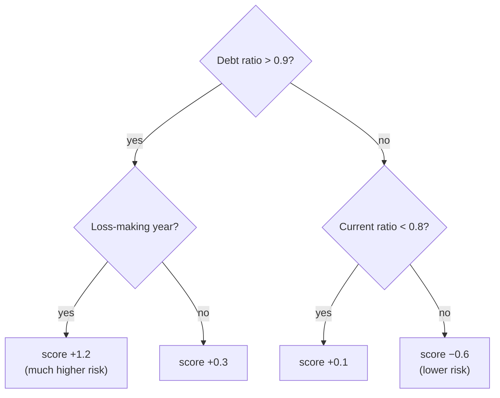

# Finnish SME Bankruptcy Prediction

**Predicting insolvency risk in Finnish small and medium-sized enterprises (SMEs) from their financial statements, using machine learning.**

**Author:** [Ville Nurminen](https://www.linkedin.com/in/villenurminen/)

| Link | Type | What it contains |
|---|---|---|
| 🔗 **Live app** *(coming soon)* | Web app | Data, model results and an interactive risk calculator |
| [`01_Build_dataset.ipynb`](01_Build_dataset.ipynb) | Code: notebook | Data loading, cleaning and feature engineering |
| [`02_Train_and_evaluate.ipynb`](02_Train_and_evaluate.ipynb) | Code: notebook | XGBoost training, evaluation, probability correction and SHAP |
| [`03_Demo_app.py`](03_Demo_app.py) | Code: app | The Streamlit app, built on the aggregate results in [`results/`](results/) |

> **About this project:** This is a portfolio and technology demonstration.
> The company data comes from Moody's, accessed under an academic licence
> through Tampere University of Applied Sciences (TAMK). Licence terms do not
> allow the data to be redistributed, so this repository contains the code,
> methodology and aggregated results only, not the underlying company data.

## Contents

1. [The problem](#the-problem)
2. [Data](#data)
3. [Why XGBoost?](#why-xgboost)
4. [Approach](#approach)
5. [Results and limitations](#results-and-limitations)
6. [Further development](#further-development)
7. [Tech Stack](#tech-stack)
8. [Data and licence](#data-and-licence)

## The problem

When a private company runs into trouble, there is no share price to signal it. Lenders, suppliers, investors and auditors have to judge financial health from annual financial statements alone — often with limited time and only a few years of data.

Classic bankruptcy models such as Altman's Z-score were built on large, listed US manufacturing firms decades ago, and they are a poor fit for Finnish SMEs. The Z-score needs variables such as the market value of equity, retained earnings, EBIT and sales. A private company has no market value at all, and the other items are often missing from the accounts that smaller companies publish.

This project asks a practical question: **how well can a company's latest financial statements distinguish firms that went bankrupt from those that stayed solvent?** It focuses on Finnish SMEs with accounts from 2022–2024, uses a gradient-boosted model (XGBoost) that captures non-linear relationships and interactions between financial ratios, and uses SHAP to show which financial signals drive each prediction.

---

## Data

Financial statement data was obtained from Moody's (Orbis database). The target population is Finnish limited companies matching these search criteria:

- Status: active, bankrupt, or dissolved through bankruptcy
- Revenue ≥ €200,000 and total assets ≥ €100,000
- Excluded industries (NACE sections): K (finance), O (public administration), P (education), Q (health), D (energy), T (households), U (extraterritorial)

The search had no upper size limit, so it also returned large companies and group parents. The project is limited to **SME-sized companies: total assets of at most €43M** in the latest year (the EU SME balance-sheet threshold; the full EU definition also uses employees and turnover, which are not in the data). Large companies are a different population and are almost never bankrupt, so including them would mostly teach the model that "big means safe".

Within this scope the population is about **62,176 companies, of which 1,128 (1.81%) are bankrupt**. The search returned 64,052 companies (1,136 bankrupt) without the size limit; the SME-scope counts are estimated from the share of sample companies that fall under the limit (97% of active and 99% of bankrupt companies), which is valid because the active companies are a random sample and all bankrupt companies were exported.

### Sample design

Bankruptcy is rare, and the database caps the size of a single export. The sample was therefore built from two exports:

| Group | Population (SME scope) | Exported |
|---|---:|---:|
| Active companies | 61,048 | 9,100 (random sample) |
| Bankrupt companies | 1,128 | 1,136 (all) |
| **Bankruptcy share** | **1.81%** | 11.1% |

Every bankrupt company is included, while active companies are a random sample of about 1 in 7. Keeping all bankruptcies gives the model as many failure cases to learn from as possible. A purely random sample of the same size would contain only around 180 bankrupt companies.

The trade-off is that bankruptcies are about 6× more common in the sample than in reality, and a model learns the bankruptcy rate it is trained on. Its raw probabilities therefore overstate real-world risk: a company scored at 30% in sample terms has a real-world probability of about 6%. Because the sampling rates are known exactly, the probabilities are corrected back to the 1.81% population rate after training (see *Evaluation*). The correction does not change which companies are ranked as riskier, only how the probabilities read.

For each company the data contains five financial statement items for 2022–2024 (profit/loss before tax, total assets, current assets, current liabilities and shareholders' funds), plus its industry (NACE Rev. 2) and year of incorporation. The model uses **one row per company: its latest year of accounts**, with changes from the previous year as additional features (see *Approach*).

### Class imbalance

Even in the sample, active companies outnumber bankrupt ones about 8 to 1. The classes are **not reweighted** during training: an 8:1 ratio is mild, and upweighting bankruptcies would exaggerate a class that is already over-represented. The sampling bias is corrected on the probabilities instead (see *Sample design*).

### Missing values and data availability

Bankrupt companies stop publishing financial statements after they fail, so they have fewer years of data, and their latest accounts are often from 2022 or 2023 while active companies' are from 2024. Remaining gaps, such as year-over-year changes for a company with only one year of data, are left as missing values, which XGBoost handles natively.

This creates patterns the model could exploit without learning anything about finances: the year of the latest accounts, or how many years a company reported, would reveal *when the records end* rather than how healthy the company was. Neither is used as a feature, so the model has to rely on the financial figures themselves.

### Bankruptcy timing

The export records each company's bankruptcy status at the time of extraction. The date of the bankruptcy is **not available in the Moody's data**: the database has a status-change date, but it records when the status was updated in the database rather than when the company failed (most fall in 2022–2024 regardless of the actual bankruptcy), so it cannot be used as the bankruptcy date. The model therefore classifies companies by the financial profile in their **latest accounts** (for a bankrupt company, the last accounts before failure) rather than forecasting bankruptcy a fixed number of years ahead. With bankruptcy dates, each year of accounts could be labelled "fails within the next 12 months", which would extend the model to a time-specific forecast such as one-year-ahead bankruptcy risk.

The data itself is not included in this repository. See [*Data and licence*](#data-and-licence).

---

## Why XGBoost?

### What it is

XGBoost (eXtreme Gradient Boosting) is built from many small **decision trees**.

**One decision tree** asks a short sequence of yes/no questions about a company and ends in a
*leaf* that holds a score. A tree with a depth of two might look like this:

The questions and the cut-off values are not set by hand: during training the tree tests many
possible splits and keeps the ones that best separate bankrupt from active companies.

**Boosting** builds trees one after another, each correcting the errors of the ones before it:

1. The first tree makes a rough prediction for every company.
2. The next tree is trained on what the first got wrong, for example bankrupt companies that
   were scored too low, and adds a correction.
3. This repeats, here 500 times. Each correction is scaled down (learning rate 0.05), so the
   model improves in many small, careful steps rather than a few large ones.

A company's final score is the **sum of the leaf scores from all trees**, converted into a
probability. Because every tree is small (at most four questions deep in this project), each
step stays simple and interpretable, while the hundreds of trees together can capture complex,
non-linear patterns such as "high debt is dangerous mainly when the company is also making
losses".

### Why it fits this problem

| Property of the problem | How XGBoost handles it |
|---|---|
| **Tabular data** — financial statement items and ratios | Gradient-boosted trees are consistently among the strongest methods for structured, tabular data |
| **Non-linear effects** — risk jumps sharply once equity turns negative or debt exceeds assets | Trees split at thresholds, so they learn such cut-offs directly instead of assuming a straight-line relationship |
| **Interactions** — high debt matters more for a loss-making company | Each tree combines several features in sequence, capturing combinations automatically |
| **Missing values** — e.g. no year-over-year change in a company's first year | Handled natively: each split learns the best direction for missing values, without imputation |
| **Skewed figures and outliers** — company sizes range from €100k to €43M | Tree-based models in general do not need feature scaling: a split only asks whether a value is above or below a cut-off, so only the order of values matters. No standardisation or log-transforms are needed, and extreme values do not dominate (unlike linear models, neural networks or distance-based methods, which require scaling) |
| **Moderate data size** — about 10,000 companies | Regularisation, shallow trees and row/feature subsampling keep the model from memorising individual companies |
| **Need for explanations** — a risk score is only useful if you can say *why* | SHAP's TreeExplainer computes exact feature contributions for tree models, so every prediction can be broken down feature by feature |

### Trade-offs

- **Less transparent than a simple scorecard.** A single equation is easier to read than hundreds of trees. SHAP closes most of this gap by explaining both the model as a whole and each individual prediction.
- **Can overfit.** Boosting fits the training data closely, so performance is judged only on companies the model has never seen (cross-validation and a held-out test set), and the train/validation gap is reported openly.
- **Raw probabilities reflect the training sample.** Because bankruptcies are over-represented in the sample, predicted probabilities are corrected to the real population rate before they are interpreted as risk levels.

---

## Approach

### From raw data to features

The two exports are merged, labelled (0 = active, 1 = bankrupt), cleaned of duplicate exports, given a unique company ID and reshaped into a **company-year panel**: one row per company per financial year. Features are computed on the panel, then each company is reduced to **its latest year**, so every company appears exactly once. History is carried in the change features, which compare the latest year with the year before:

| Feature              | What it measures                             | Why it matters                                                            |
| -------------------- | -------------------------------------------- | ------------------------------------------------------------------------- |
| Debt ratio           | Total liabilities / total assets             | Leverage. Values above 1 mean liabilities exceed assets                   |
| Current ratio        | Current assets / current liabilities         | Short-term liquidity. Below 1 means short-term debts exceed liquid assets |
| Return on assets     | Profit before tax / total assets             | Profitability relative to the asset base                                  |
| Negative equity flag | Shareholders' funds < 0                      | Accumulated losses have wiped out the equity                              |
| Loss-year flag       | Profit before tax < 0                        | The company made a loss that year                                         |
| Asset growth         | Year-over-year change in total assets, relative to the prior year | A shrinking balance sheet can signal distress        |
| Equity change        | Year-over-year change in shareholders' funds, relative to prior-year total assets | Eroding equity is a strong warning sign |
| Debt ratio change    | Debt ratio this year minus last year         | Rising leverage shows a weakening balance sheet                           |
| ROA change           | Return on assets this year minus last year   | Falling profitability is an early sign of trouble                         |
| Total liabilities    | Total assets − shareholders' funds          | Derived, as the data does not report it directly                          |
| Non-current assets   | Total assets − current assets               | Derived balance sheet structure                                           |

Each company row also includes the five reported figures, company age and industry section. Ratios are set to missing rather than extreme values when the denominator is effectively zero (below €1,000), so a near-empty balance sheet does not produce misleading outliers. Change features compare only consecutive calendar years of the same company, and are missing for companies with a single year of data.

### Evaluation

- **Train/test split:** 80% of companies for training, 20% held out and scored only once at the end. The split is stratified, so both sets keep the same share of bankruptcies, and each company is a single row, so no company appears in both.
- **Cross-validation:** 5-fold stratified cross-validation on the training set estimates performance and how stable it is.
- **Decision threshold:** chosen to maximise F1 (the balance of precision and recall) on the cross-validated training predictions, then applied unchanged to the test set, so the test set is never used for tuning.
- **Two base rates:** results are reported both for the sample and for the real population, where precision and Average Precision are re-estimated at the 1.81% bankruptcy rate.
- **Explanations:** SHAP shows which features drive the model's predictions, as averages over the test companies.

---

## Results and limitations

The full results are in the **[app](#finnish-sme-bankruptcy-prediction)** *(link coming soon)*: cross-validation, ROC and precision–recall curves at both base rates, calibration, how the cut-off was chosen, SHAP explanations, and a risk calculator.

### Headline results

Measured on a held-out test set of companies the model never saw:

| | Result | For comparison |
|---|---:|---|
| **ROC-AUC** | **0.907** | 0.5 = random ranking |
| Cross-validation ROC-AUC | 0.897 ± 0.006 | stable across 5 folds (0.891–0.904) |
| **Bankruptcies caught** (recall) | **70%** | at the chosen cut-off |
| **Average Precision**, sample | 0.658 | random: 0.114 |
| **Average Precision**, real population | 0.355 | random: 0.018 (≈ 20× better) |

**What this means in practice.** The model ranks a bankrupt company above an active one in about 91 of 100 random pairs. At the chosen cut-off it catches 70% of bankruptcies. In the sample, half of the flagged companies failed; in the real population, where healthy companies are far more common, about **1 in 8** flagged companies fails. That is still about **7× the average failure rate**, which makes the model useful for narrowing down which companies deserve a closer look, not for deciding on its own.

**Strongest warning signs** (SHAP): a **high debt ratio**, weak **return on assets**, and a **debt ratio that rose over the latest year**. Debt ratio alone has about twice the average impact of any other feature. These are the classic signs of financial distress (leverage, profitability and a worsening trend), which suggests the model has learned financially meaningful patterns rather than quirks of the data.

### Limitations

- **No bankruptcy dates.** The data shows *whether* a company went bankrupt, not *when*. The model classifies companies by the profile in their latest accounts rather than forecasting failure a fixed time ahead.
- **Estimated population figures.** The SME-scope population counts are estimated from the sample, not taken directly from the database, so the real-world probabilities carry some extra uncertainty.
- **SME defined by total assets only.** Employees and turnover, part of the EU definition, are not in the data.
- **Consolidated accounts.** Some companies may report group-level accounts; the data did not include the consolidation code needed to separate them.
- **Data availability.** Bankrupt companies stop filing after they fail, so they have shorter histories. The calendar year and the number of years reported are excluded as features, but companies with only one year still lack the year-over-year changes, which the model may partly read as a risk signal.
- **A specific period.** Accounts cover 2022–2024, a period of rising interest rates; patterns may differ in other economic conditions.
- **The calculator is simplified.** It uses only the inputs a user can set (key ratios, age, size and industry), so it is less accurate than the full model.

---

## Further development

### Improving this model

- **Bankruptcy dates.** With them, each year of accounts could be labelled "fails within the next 12 months", extending the model to time-specific forecasts such as one-year-ahead risk (a survival or hazard model).
- **Richer accounts.** Revenue, cash, employees and a longer history would add signals the current five items cannot capture. Some of these exist in the database, but coverage is weakest for the smallest companies, which in Finland are only required to file a balance sheet, and those are the companies most likely to fail. Filling the gaps would mean going through the filed financial statements themselves.
- **Out-of-time validation.** Train on 2022–2023 and test on 2024, to check that the model holds up on a later period, not just on unseen companies.

### From prototype to production

This model uses only published annual accounts, which arrive months after the year ends. A lender would build a production model on **its own, far more timely data** and use published accounts as one input among several:

- **Payment behaviour on its own loans:** late or missed instalments, how long payments are overdue, and how often.
- **Account and limit usage:** falling balances, growing overdraft or credit-limit utilisation, irregular cash flows.
- **External registers:** payment default records and public tax debt registers, which often show distress well before the next annual accounts.
- **Monthly rather than yearly updates**, so a deteriorating customer is spotted within weeks, not a year later.
- **Derived cash flow:** small companies are generally not required to prepare a cash flow statement, yet a company fails when it runs out of cash, not profit. An approximate cash flow can be derived from consecutive balance sheets and the income statement (the indirect method: profit adjusted for depreciation and changes in working capital). With depreciation and debt repayments added, this would allow debt-service ratios such as operating cash flow relative to loan payments, a standard measure in credit analysis.

Running such a model in practice also needs more than accuracy: regular monitoring for drift as economic conditions change, periodic recalibration of the probabilities, documented validation, and explanations for each decision. Credit models are subject to regulatory model-risk requirements, and the SHAP explanations used here are one way to meet the explainability part.

---

## Tech Stack

| Tool/Library                                                                                                             | Role in this project                                                                       | Homepage                                  |
| ------------------------------------------------------------------------------------------------------------------------ | ------------------------------------------------------------------------------------------ | ----------------------------------------- |
|                     | Core programming language                                                                  | [Python](https://www.python.org/)          |
|                     | Panel construction (~28,000 company-years), feature engineering, per-company model dataset | [pandas](https://pandas.pydata.org/)       |
|                        | Numerical computations and array operations                                                | [NumPy](https://numpy.org/)                |
|                               | Bankruptcy prediction model — gradient boosting on financial statement data                | [XGBoost](https://xgboost.readthedocs.io/) |
|                                     | Model interpretability — which financial ratios drive insolvency predictions              | [SHAP](https://shap.readthedocs.io/)       |
|  | Stratified cross-validation, train/test split, evaluation metrics                          | [scikit-learn](https://scikit-learn.org/)  |
|            | Interactive web app: data, results and risk calculator                                     | [Streamlit](https://streamlit.io/)         |
|                     | Interactive charts in the app                                                              | [Plotly](https://plotly.com/python/)       |
|         | Quick visual checks in the notebooks                                                       | [Matplotlib](https://matplotlib.org/)      |
|                                 | Python environment and dependency management                                               | [uv](https://docs.astral.sh/uv/)           |
|                  | Interactive development environment                                                        | [Jupyter](https://jupyter.org/)            |

---

## Data and licence

The financial statement data was obtained from Moody's under an academic licence held by Tampere University of Applied Sciences (TAMK), and is used here for non-commercial, educational purposes only.

- **Not included in this repository:** the raw exports, the processed dataset (`model_data.csv`) and any company-level records. These are excluded via `.gitignore`.
- **Included:** all code, the methodology, and aggregated results in `results/` (metrics, curves and summary statistics; groups of fewer than 20 companies are suppressed). The app reads only these files.
- **Reproducing the results** requires your own access to Moody's company data. The search criteria used are listed under [*Data*](#data).

The code is released under the [MIT License](LICENSE); the licence does not cover the company data.
