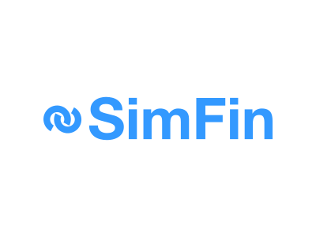

Data Analytics Demo by Ville Nurminen
======================

[Ville Nurminen's LinkedIn Profile](https://www.linkedin.com/in/villenurminen/)

This section provides an overview of the purpose and scope of the Data Analytics Demo. The repository showcases Python-based data analytics techniques, with a focus on financial statement analysis. Authored by Ville Nurminen, the project is intended solely for demonstration purposes, including all data, analyses, and conclusions. This project is covered under the [MIT License](LICENSE), allowing for reuse with proper attribution.

This file lists all the Python libraries and dependencies required to run the project. Install them using `pip install -r requirements.txt`. [requirements.txt](requirements.txt):

The project is structured into several Jupyter notebooks, each focusing on different aspects of the data analytics process, from data collection to model implementation. The key components include: data visualization, statistical modeling, and machine learning techniques such as XGBoost.

### Summary of key technologies used:
| Tool/Library | Description | Homepage |
|--------------|-------------|----------|
| 

 | NumPy: A library for numerical computations in Python, supporting arrays and matrices. | [NumPy Homepage](https://numpy.org/) |
| 

 | Python: The programming language used for this project. | [Python Homepage](https://www.python.org/) |
| 

 | Seaborn: A Python visualization library based on Matplotlib. | [Seaborn Homepage](https://seaborn.pydata.org/) |
| 

 | Matplotlib: A comprehensive library for creating static, animated, and interactive visualizations in Python. | [Matplotlib Homepage](https://matplotlib.org/) |
| 

 | Scikit-learn: A machine learning library for Python. | [Scikit-learn Homepage](https://scikit-learn.org/) |
| 

 | Pandas: A data manipulation and analysis library for Python. | [Pandas Homepage](https://pandas.pydata.org/) |
| 

 | Jupyter Notebook: An interactive environment for running Python code. | [Jupyter Homepage](https://jupyter.org/) |
| 

 | SimFin: A third‑party service delivering financial information. | [SimFin Homepage](https://www.simfin.com/en/) |
| 

 | XGBoost: An optimized gradient boosting library for machine learning. | [XGBoost Homepage](https://xgboost.readthedocs.io/) |